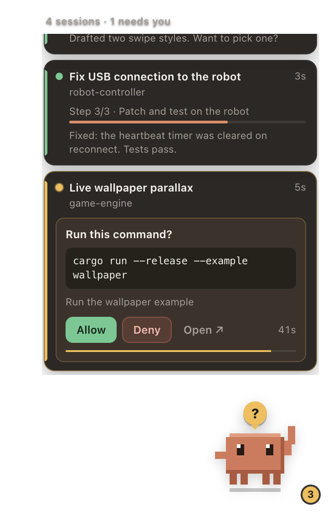
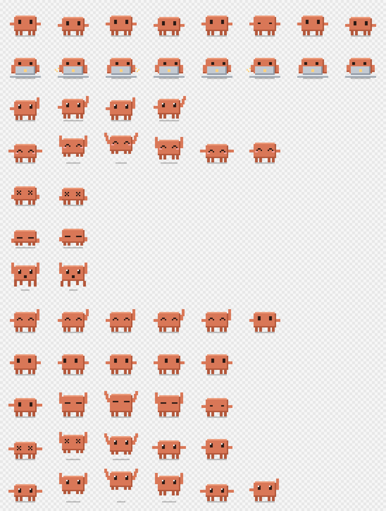
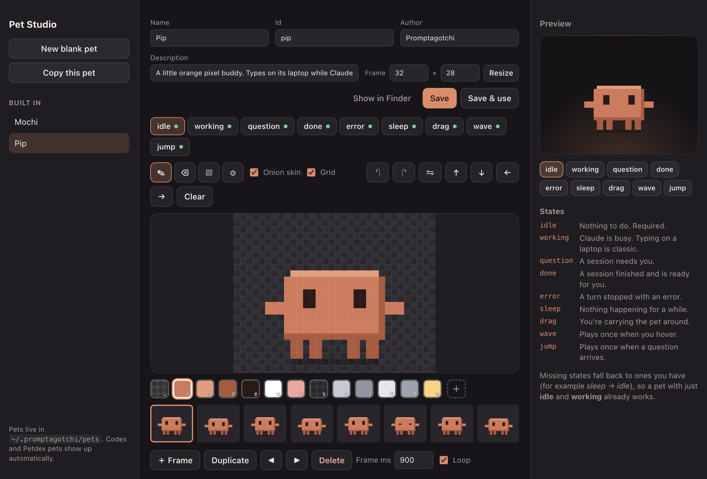

# Promptagotchi

**A tiny pixel desk pet that floats on top of your screen and keeps an eye on every Claude Code session.**

It types on its little laptop while Claude works, waves a question mark when a session needs you, and does a happy hop when something's ready. Hover it to see what each session is doing (which tool, which plan step, which subagents), answer prompts right from the pet, or click to jump straight to the session that needs you. No more alt-tabbing through five Claude windows to find the one that's waiting.

<p align="center">
  
  &nbsp;&nbsp;
  
</p>

> Unofficial fan project, not made by or affiliated with Anthropic. "Claude" is a trademark of Anthropic.

## What it does

- **Floats above everything:** all Spaces and full-screen apps, and it never steals focus.
- **Lives anywhere:** drag it to any edge or corner of any screen. It scales with the screen it's on (bigger monitor, bigger pet) and remembers its spot as a share of that screen.
- **Animates by state:**

  | Your sessions | The pet |
  | --- | --- |
  | Any session needs you (permission prompt, question) | Jumps, then waves under a **?** bubble |
  | A session finished and is ready for you | Happy hop, **✓** bubble |
  | Claude is working | Types on its laptop (a number bubble shows how many sessions are working) |
  | Nothing going on | Stands around and blinks, then naps (**z z**) |

- **Hover for the stack:** one card per session, with its title and project, the live activity ("Running: npm test", "Editing src/app.ts"), the current plan step ("Step 3/7 · Draw pixel pet"), and running subagents with what each is doing.
- **Answer from the pet:** permission prompts get **Allow / Deny** buttons. Claude's multiple-choice questions get the option buttons. See [Answering prompts](#answering-prompts).
- **Click to jump:** click a card (or the pet itself, to go to whoever needs you most) and it opens that exact session. That's the Claude desktop app's Code tab, a Terminal.app / iTerm2 tab, or VS Code.
- **Works with zero setup:** it reads Claude Code's own session status files. Connect the optional hooks for the live details.
- **Bring your own pet:** draw one in the built-in **Pet Studio**, hand-write pixels in a JSON file, drop in GIFs or a sprite sheet, or load the **Codex / Petdex pets** you already have.

## Install

1. Download **Promptagotchi-…-macOS.dmg** from [Releases](../../releases) and open it.
2. Drag **Promptagotchi** into **Applications**.
3. Open it from Applications. Pip pops onto your screen and the Promptagotchi window opens.

macOS says it can't verify the app? It isn't from the App Store or notarized. Click **Done**, double-click **Open Security Settings** in the disk image, click **Open Anyway**, then open Promptagotchi again. You only do this once.

Quit it whenever you like (menu-bar critter → **Quit**). Opening the app again puts the pet right back.

It opens by itself when you log in, so the pet is always there. Turn that off in **Settings → Startup**.

### Run from source

You need [Rust](https://rustup.rs) and [Node.js](https://nodejs.org) 20+ (Node is only for the Tauri command-line tool).

```bash
git clone https://github.com/AloeVeraZ/promptagotchi.git
cd promptagotchi
npm install
npm start           # the pet + the app window (debug build)
npm run dist:mac    # build the .app and the drag-to-Applications .dmg into dist/
```

Want to see every state without Claude running? Open **Debug → Start simulator**. **Stop simulator** removes all the pretend sessions again.

### Connect live hooks (recommended)

Hover the pet and click **Connect + answering** (or **Status only**). This adds Promptagotchi's hooks to `~/.claude/settings.json`:

- Your existing settings and hooks stay as they are, and a backup goes to `settings.json.promptagotchi-backup`.
- The status hooks are `async`, so they never slow Claude down.
- If the pet isn't running, the hook exits in milliseconds and does nothing.
- Undo it any time: right-click the pet → **Claude Code → Disconnect hooks**.

If a session that was already open doesn't start showing live tool activity, restart it.

## Using it

### The app window

Open Promptagotchi (or click its Dock icon) for a window with two tabs:

- **Run:** the pet and its size, the Claude Code connection, every session in a table, a live feed of hook events, a simulator, and debug info.
- **Editor:** Pet Studio, for drawing and tweaking pets.

Close the window and the pet keeps running; it lives in the menu bar.

### The pet

| Do this | To |
| --- | --- |
| Hover the pet | See your sessions: the three nearest the pet, and scroll for the rest |
| Hover a session card | Unfold all of its subagents |
| Click the pet | Jump to the session that needs you (or pin the list open) |
| Click a card | Open that exact session |
| Press **×** on a card | Close a finished or closed session. They stay until you do. **Clear finished** closes them all. |
| Drag the pet | Put it anywhere: any edge, corner or screen. The list opens on whichever side has room |
| Right-click the pet / click the menu-bar icon | Pick a pet, size (relative to the screen), sound, hooks, Pet Studio, quit |
| <kbd>⌥ Option</kbd> <kbd>⇧ Shift</kbd> <kbd>P</kbd> | Show / hide the pet |

### Answering prompts

When **Answer prompts from the pet** is on and a session asks for permission while **you're in some other app**, the pet holds the prompt and shows it with buttons:

- **Allow / Deny** answers it, and Claude carries on.
- **Open ↗** takes you to the session.
- If you switch to the app running that session, or don't answer within the hold time (45 s by default; change it in **Claude Code → Hold prompts for**), the prompt goes back to Claude's own window. Nothing is ever lost.

If you're already looking at that session's app, the pet doesn't hold anything. It just points.

Claude's multiple-choice questions (`AskUserQuestion`) work the same way: tap an option, or **Type my own in Claude ↗**.

The button you press pops in a little pixel burst, and the prompt swipes off into nothing.

### Whip mode

Press <kbd>⌃</kbd> <kbd>⇧</kbd> <kbd>W</kbd> (change it in **Settings → Shortcuts**) and your cursor grows a pixel whip.

- Bring it near your pet. Once you're close enough, the lash swings at the pet by itself, with a whiplash smear on fast swings.
- When it lands, it cracks, the pet flinches, and it goes into **⚡ Hustle mode** for a while. It types twice as fast and sweats, and the session list shows ⚡. Every hit adds time.
- Misses are silent.

Hustle mode is purely the pet's animation. It never touches Claude, your sessions or your code. For a faster Claude, use `/fast` in Claude Code.

## Make your own pet

Right-click the pet → **Pet → Pet Studio…** to draw one frame by frame with a live preview. Or see **[docs/making-pets.md](docs/making-pets.md)**.

<p align="center"></p>
 A pet is just a folder with a `pet.json`, and it can be:

- **Text pixels:** each frame is a grid of characters mapped to colors. [Mochi](pets/mochi/pet.json) took about ten minutes.

Three pets come built in: **Pip** (the little orange one), **Mochi** (a squishy blob) and **Volt** (a neon cyberpunk critter that hacks on a hologram while Claude works).
- **GIFs:** one animated GIF / APNG / WebP per state.
- **Image frames or a sprite sheet.**
- **A Codex or Petdex pet:** anything in `~/.codex/pets` or `~/.petdex/pets` shows up automatically.

Only `idle` is required; every other state falls back gracefully.

## How it works

The short version:

- Claude Code keeps a status file per running session in `~/.claude/sessions/`. Promptagotchi watches those, which gives it the session title, folder, and busy / idle state with zero setup.
- The optional hooks post each event to a tiny server on `127.0.0.1`, protected by a random token. That adds tool activity, subagents, plan steps, and the prompts you can answer.

Full details, including every file it touches, are in **[docs/how-it-works.md](docs/how-it-works.md)**.

## Privacy

Everything stays on your machine. Promptagotchi makes no network requests. The hook server only listens on localhost, needs a per-install token, and rejects browser requests. Prompts and commands are shown in the overlay and never stored.

## Platform support

- **macOS:** everything. The app is about 5 MB (it uses macOS's own WebKit, not a bundled browser).
- **Windows / Linux:** not yet. The Rust core is cross-platform, but the overlay windows, session jumping and frontmost-app checks are macOS-specific today.

## Development

Promptagotchi is a **Rust** app built with [Tauri](https://tauri.app). The Rust core in `src-tauri/` does all the work: sessions, the hook server, windows, menus, shortcuts and placement. The screens are small HTML pages in `src/renderer/`.

```bash
npm start           # run it (debug build)
npm test            # the Rust test suite (cargo test)
npm run dist:mac    # Promptagotchi.app + .dmg in dist/
npm run build:pip   # regenerate Pip (also build:volt)
npm run preview -- pets/mochi   # render a pet's frames to preview.png
```

The pet-art scripts in `scripts/` are small Node helpers for drawing pets; they aren't part of the app.

Set `PROMPTAGOTCHI_DEBUG=1` for logs. See [CONTRIBUTING.md](CONTRIBUTING.md).

## Roadmap

- Notarized builds, a universal (Intel + Apple silicon) DMG, and Windows
- "Always allow" from the pet
- A pet gallery
- Per-session pets (a different critter for each project)

## License

MIT. Pets in `pets/` are MIT too. Make all the derivatives you like.
